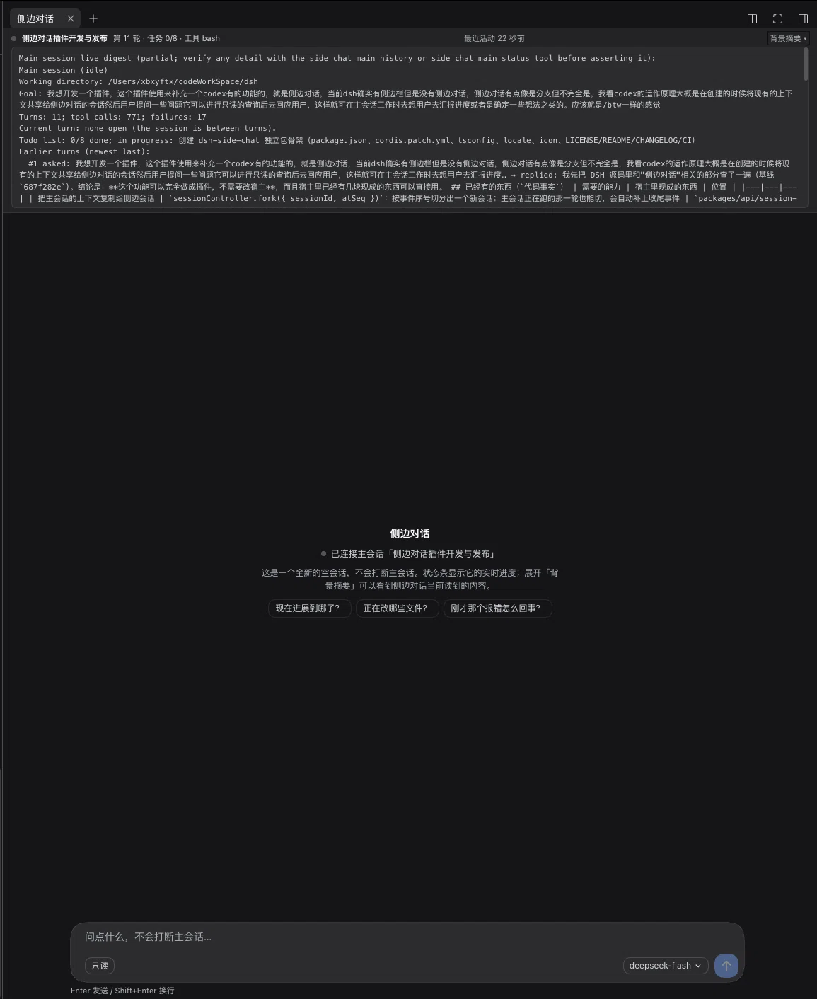
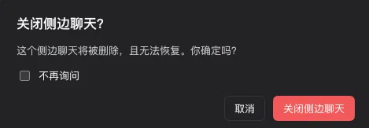
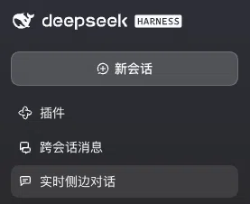
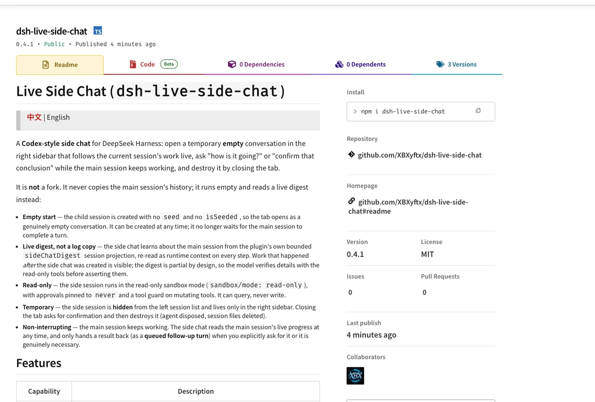

## 前言：一句不敢问的话

主会话跑一个长任务，十分钟、二十分钟，甚至更久。我坐在屏幕前，想确认一句"现在到哪了"，但输入框一发送，主会话就被打断：它得停下来处理我的问题，原本的工作流被切成两段。

这个形态的灵感来自 Codex 的侧边对话。它不是再开一个对话，而是给当前会话配一条旁路：主会话继续跑，我在旁边问，得到的答案来自主会话正在进行的状态，而不是我记忆里的、或者某个已经过期的快照。

我第一版做错了。这篇文章主要讲它错在哪、怎么改的，以及改对之后还剩下哪些不体面但真实的限制。

## 一、先讲一个错误答案：把主会话历史 fork 进去

0.1.0 的思路是"给子会话喂上下文"：取主会话最近一个已完成的轮次，用 `buildForkSeed` 复制成种子，创建一个隐藏的只读子会话。打开侧边对话，立刻能看到主会话的历史，然后基于这些历史提问。

从"聊天"的角度看，这很自然；从"实时进度"的角度看，它从根上错了。

用户实测后给的原话是（2026-10-30）：

> 我想解决的是主会话在处理一个长时间的任务时如果用户想聊些东西，想确认进度就会打断主会话工作，所以侧边会话不能只把上下文停留在上一次会话的结束，应该更进一步，能实时的看到主会话正在进行的任务状态。

三个问题是代码结构决定的，不是配置能救回来的：

1. **拿不到正在进行的这一轮**。fork 的种子切点必须是已完成轮次，所以"正在跑的第 4 步"永远在切点之后；它只会出现在主会话未来的日志里，不会出现在种子里。
2. **主会话首轮没完成时，根本创建不了侧边对话**。没有已完成轮次 → 没有切点 → 直接报 `no-completed-turn`。
3. **打开就是整段旧历史**，和"空会话"相反。种子事件在客户端按普通消息渲染，用户看到的是一份历史拷贝，不是一条等待提问的新对话。

我一开始把问题理解成"怎么把上下文带过去"，而用户要的是"怎么看到现在"。方向错了，做得再完整也没用。

## 二、重新设计：空会话 + 实时摘要

0.2.0 推翻了 fork，换成一套完全不同的机制。核心只有一句：**侧边对话不继承历史，它读取主会话的实时摘要**。

```text
主会话（agent-loop 正在跑）
  │ 每条已提交事件 → sideChatDigest 会话投影（纯同步、有界、增量 fold）
  │      ├─ 同步读取 → systemPrompt.context：每步刷新注入
  │      └─ wire 值 → session.control 流 → 浏览器状态条 + 背景摘要面板
  ▼
侧边会话（空会话、只读）
  ├─ side_chat_main_status：最新摘要 + 主会话运行态
  ├─ side_chat_main_history：按 turn / contains 查主会话真实日志行（有界）
  └─ side_chat_report：把结论排队进主会话后续轮次（不打断）
```

创建子会话时不再传 `seed`、不设 `isSeeded`，只保留 `parentSession` 血缘和 `origin: 'subagent'`，所以标签页打开就是一条真正的空对话；主会话首轮没跑完也能创建。

### 2.1 为什么是"会话投影"

`sideChatDigest` 是插件注册的会话投影（`src/digest.ts`）：框架在每条已提交事件上驱动一次纯同步 fold，投影缓存负责持久化，`wire` 单元经 `session.control` 自动推给浏览器。

选它而不是自己订阅事件，图的是"一次折叠，三方消费"：

- **模型**：`systemPrompt.context({ name: 'side-chat:main-digest', order: 220, text: () => ... })` 每步同步重读；
- **状态条**：浏览器直接读 `projectionsBySession`，不需要 retain 主会话（不打开历史、不唤醒 Agent）；
- **重启恢复**：投影缓存落盘，重启后摘要还在，侧边对话和背景摘要面板能恢复。

摘要字段都是有界的：`goal`、`turns[]`（每轮一行）、`openTurn`（正在进行的轮次：提示、步数、最新助手文本、最近工具调用、失败数、开始时间）、`todos[]`、`recentTools[]`、`lastError`、`counts`、`lastActivityAt`、`model`。所有字符串截断，所有数组有上限（`digestTurns` 默认 12，可配 4–60）。

### 2.2 为什么必须是同步的

`systemPrompt.context` 的 provider 会在 pre-step 与每次请求 admission 时求值，**不能 await**。所以 provider 里只能同步读 `ctx.sessionProjections.stateOf()`；主会话不 live 时，用创建/恢复时读到的投影值兜底，并在注入块里明说"没有实时摘要"。

也可以像 `dsh-session-reference` 那样在 `agent/pre-step` 插一条消息，但那会产生一条**可见**的持久 user 消息，而且只是一时点快照；我们要的正是"每步刷新、且是背景而不是对话"，所以选了运行时上下文 provider。

### 2.3 提示词纪律：摘要不是日志

摘要天然不全：它没有工具结果、文件内容、中间步骤，早期轮次只有一行。如果模型把它当完整日志，就会一本正经地断言"已完成 / 已改文件 / 已修复"。

所以注入块的第一行就是：

```text
Main session live digest (partial; verify any detail with the side_chat_main_history or
side_chat_main_status tool before asserting it):
```

角色提示词（`side-chat:role`）再写一遍：这是 DIGEST，不是日志；断言实际改动前必须先调只读工具；拿不到答案就直说，不要猜。

## 三、两个平台细节，决定了产品形态

### 3.1 运行时上下文只追加，不替换

dsh 的运行时上下文快照不是"替换上一份"，而是每次变化追加一条新的 `user/message`，旧的还在模型历史里，"supersedes" 只是文字声明。

这带来一个直接约束：**摘要里不能放高频变化字段**。否则侧边对话每步都会多一条快照，上下文迅速膨胀。因此摘要用"开始时间"而不是"已运行 N 秒"，数组全部设上限，多数步骤文本不变、不重复追加。即便如此，侧边对话自身每步若摘要变化，仍会多一条快照——这是有意的代价，临时会话影响有限。

### 3.2 注入内容在聊天流里不可见

dsh 有意在 Chat 里过滤普通运行时上下文行（`isVisibleChatNode` 只放行带工具增删的 context），所以注入块**不会**出现在侧边对话的聊天记录里。

这不是 bug，是上游的产品设计。但用户需要核对"模型到底看到了什么"，于是状态条里加了「背景摘要」折叠面板：展开后经 `POST /side-chat/digest` 取回文本，和注入共用同一个渲染函数，逐字一致，不会漂移。



*状态条、展开的背景摘要、空会话问候卡与底部输入框（0.3.0）*

## 四、只读、隐藏与"真销毁"

### 4.1 只读三层

侧边对话跑在只读沙箱里：`sandbox/mode: read-only`、`approval/policy: never`、`tools.guard()` 拒绝写类工具（write/edit/bash 等）。它只能查询，不能改文件。

诚实地说，`read-only` 只保证写不进去，`bash` 仍可以执行只读命令；这是沙箱语义的边界，不是插件能补的。

### 4.2 隐藏：借用 subagent 语义

侧边会话必须从左侧列表消失。做法是 `origin: 'subagent'`（左侧列表据此过滤），并自写 `subagent/descriptor`——Web 端对 `origin: 'subagent'` 的会话默认拒绝普通历史读取，只有带 descriptor 投影的子会话才能通过 subagent 路由读历史。

这是"借用上游机制"，不是官方扩展点；上游升级 descriptor 版本时需要同步，属于已知维护成本。

### 4.3 销毁：没有删除 API 就自己删

dsh 没有会话删除 API。`AgentHandle.dispose()` 只释放 Agent，文件还在。所以销毁分三步：释放 Agent → 删除 `$DSH_HOME/sessions/<projectKey>/<sessionId>/` → 用 `sessionPersistence.stat()` 校验是否真的删掉。校验失败如实回报，不假装成功。

关闭确认则有一个体验妥协：右侧栏没有"关闭否决"钩子，所以是**先关闭、后确认**。点取消会用 `openResourceIn` 把标签页重新打开，会有一瞬的关闭/重开。「不再询问」存在 `localStorage['dsh.side-chat.v1']`。



*关闭确认弹窗：不再询问 / 取消 / 关闭侧边聊天*

### 4.4 通信：自己挂一条受鉴权的路由

第三方插件无法生成 Typert Remote，而 Connection 的通用通道会把路由归属到服务自身上下文，所以插件直接在 Host Web 服务器上挂一条 `POST /side-chat/<endpoint>` 路由：`create` / `ask` / `models` / `select-model` / `digest` / `interrupt` / `destroy`。`connection.requestRejection()` 负责 Host/Origin 与浏览器凭据校验，请求体限制 64KB，所有入参在 handler 里重新校验。

顺带一个细节：dsh 自带的输入框不能直接驱动这个子会话（它会把 prompt 路由到 subagent 投递，需要父会话激活），所以侧边对话用插件自己的 `conversation.composer` 链条目和 `ask` 端点，把消息直接投进子 Agent 的 inbox。

## 五、界面：状态条、空会话与模型胶囊

入口有两个：右侧栏引导页的「实时侧边对话」条目，以及输入框里的 `/btw` 命令。



*左侧全局面板里的入口（显示名在 0.3.0 改为「实时侧边对话」）*

顶部状态条展示主会话标题、运行/空闲圆点、第 N 轮、todo 进度、最新工具、相对活动时间和当前轮提示。它读的是主会话的投影，不是侧边会话自己的状态——所以主会话在忙什么，一眼能看到。

空会话显示插件自己的问候卡："已连接主会话「标题」"+ 三个快捷问题（现在进展到哪了？正在改哪些文件？刚才那个报错怎么回事？）。没用 dsh 共享的空白 hero，因为它带工作区选择装饰，对一条侧边对话没有意义。输入框放在面板底部，样式对齐主对话输入框：浮起圆角卡片、`只读` 胶囊、34px 圆形发送按钮。

0.3.0 加了模型胶囊：显示下一步请求将用的模型，点开按 provider 分组列出当前 Host 能路由的全部模型。切换用 `installModelSelection(agentCtx, ref)` 接管下一步的 provider/model，只作用于这条侧边对话（从下一轮请求开始生效），不动主会话；未 live 时先记 pending，恢复时生效。摘要里的 `model` 来自 `request/header`，所以胶囊显示的是实际路由过的模型。

一个必须说清楚的边界：**目录里的模型不一定都能用**。选择器只负责路由，能不能用取决于 provider。实测中 `cd/deepseek-flash` 1 秒答出结果；`deepseek-official/deepseek-flash` 因本机 key 无效直接失败；`cd/glm-5.3-flash` 上游 500 `not implemented`。失败不会静默，会以"本轮运行失败 + 原因"出现在会话里。

## 六、验证：在真实的"进行中"里提问

验证环境是隔离的：独立 `DSH_HOME`、独立端口、独立 web profile，模型只用 `deepseek-flash`。

主会话跑到第 4 步（`bash(sleep 3 && echo "已等待 3 秒")`）时，我在侧边对话里问"现在进展到哪了？"。6 秒后它答出：8 步里完成 3 步、正在第 4 步、当前命令是什么，还复述了开头 `todo_write` 因内容重复被拒后修正的过程；对文件内容它明确写"还没有读取回来确认，不能断言"——提示词纪律生效了。

更能说明问题的是会话日志：注入块里出现了**创建之后**才发生的工具调用（`Current turn: #1 (step N)`）。这是 fork 方案永远做不到的，因为那些事件不在种子里。

第二轮长任务（6 次 `sleep 4`）进行中再问，7 秒内答出"主会话还在跑第 2 轮、todo 完成 1/12、最近一次调用是 `bash(sleep 4 ...)`"。接着验证了重启恢复（标签页、摘要面板恢复）、关闭即销毁（会话目录从磁盘移除）、主会话全程未被打断。

最后一层是用户自己的桌面客户端实测：主会话正在跑第 8 轮任务时，侧边对话是空会话，问"当前在干什么"后正确答出当前这一轮的任务、用户原话和刚发出的第一条命令，并区分了"日志里只有这一个动作，还没有改动任何文件"。用户的评价是："效果确实是正确的这非常好值得记录一下"。

CI 层面：`typecheck`、22 项单测、`build` 全绿；0.3.0 提交 `097289f` 与 0.4.1 提交 `999d634` 的 CI run（`40995726586` / `41002796045`）都 success；npm `latest` 是 0.4.1、26 个文件、MIT。

## 七、安装与版本

```sh
dsh plugin add dsh-live-side-chat
```

当前 npm `latest` 是 0.4.1，MIT；目标宿主基线是 dsh `0.2.1-rc.2`（兼容范围 `>=0.2.1-rc.2 <0.3.0`），插件 API 还是 pre-stable；装好后刷新 Web 页面，插件卡片会出现在设置 → 插件列表。

这里有个容易被问到的命名问题：npm 上的 `dsh-side-chat` 已经被第三方占用了，同类插件又把搜索结果挤得很满，所以 0.4.0 把包名和 GitHub 仓库一起改成了 `dsh-live-side-chat`——新名字同时带上 `live` 与 `side chat`，既能命中 "dsh live side chat"，也保留了 "side chat" 关键词；GitHub 旧地址会自动重定向到新仓库。旧包已经 `npm deprecate`，安装时会指向新名。



*npm 上的 `dsh-live-side-chat@0.4.1`：26 个文件、MIT、CI 与仓库链接*

版本历史：

| 版本 | 内容 |
|---|---|
| `0.1.0` | fork 主会话历史（方向错误） |
| `0.2.0` | 推翻重做：空会话 + 实时摘要 + 两个只读工具 + 状态条 + 背景摘要面板 |
| `0.3.0` | 模型胶囊/模型选择；显示名改为「实时侧边对话 / Live Side Chat」 |
| `0.4.0` | 改名：npm 包与 GitHub 仓库都改为 `dsh-live-side-chat`，功能与 0.3.0 相同 |
| `0.4.1` | 设置页加入自动版本检查（打开即查 npm registry）与作者博客跳转 |

配置项（插件行 `side-chat`）：

| 字段 | 默认 | 含义 |
|---|---|---|
| `readOnly` | `true` | 强制只读 |
| `allowReportToMain` | `true`（volatile） | 是否允许向主会话汇报，设置面板可改 |
| `liveContext` | `true` | 是否把实时摘要注入每一步 |
| `digestTurns` | `12`（4–60） | 摘要保留的已结束轮次 |
| `historyEventLimit` | `40`（5–200） | 一次历史读取最多返回行数 |
| `preset` | `""` | Agent preset，空表示继承主会话 |
| `sessionsRoot` | `""` | 会话存储根，仅用于销毁删除 |

## 八、已知限制

不想写"基本完美"，下面这些是真实存在的：

- **关闭是"先关闭、后确认"**：取消会有一瞬重开，因为右侧栏没有关闭否决钩子；
- **摘要不是日志**：有界、截断、早期轮次只有一行，细节必须靠工具查；提示词能约束但不能数学保证模型永不越界；
- **销毁依赖 JSONL 目录布局**：换持久化后端或自定义根目录时要配 `sessionsRoot`；
- **进程崩溃可能留下未销毁的隐藏会话目录**：启动时没有自动清理；
- **借用 `subagent/descriptor` 语义**：上游升级需同步；
- **只在 Web/桌面部署激活**：依赖 `connection` / `webServer`，headless profile 不加载 Host 半；
- **运行时上下文只追加**：侧边对话自身每步若摘要变化会多一条快照；
- **它不是 fork，也不是分支**：不能当普通会话继续用，聊完就关，关闭即销毁。

接下来想做的三件事：启动时清理崩溃遗留的隐藏会话目录；等右侧栏有可用的关闭否决钩子后，把「先关闭、后确认」改成真正的「先确认、后关闭」；再完善更多 provider 的兼容与模型可用性提示。

## 写在最后

第一版最大的错误，是把"上下文"当成了目标。侧边对话真正要的是**当下的可观测性**：主会话继续工作，我在旁边问，答案来自它正在做的事。

推倒重来比从零开始难，因为要承认前面那版的设计是错的。但把 fork 换成"空会话 + 实时摘要"之后，之前绕不过去的三个问题——看不见进行中的轮次、首轮没完成创建不了、打开就是旧历史——是同时消失的，不是被绕过去的。

如果你也在用 dsh，欢迎试试：

- GitHub：<https://github.com/XBXyftx/dsh-live-side-chat>
- npm：<https://www.npmjs.com/package/dsh-live-side-chat>
- 上一篇文章（跨会话消息插件）：<https://xbxyftx.top/2026/10/18/DshSessionMessaging/>
